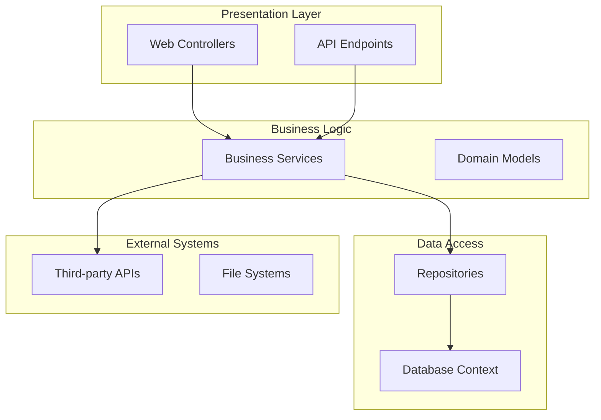
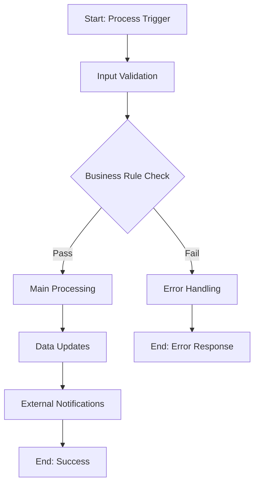
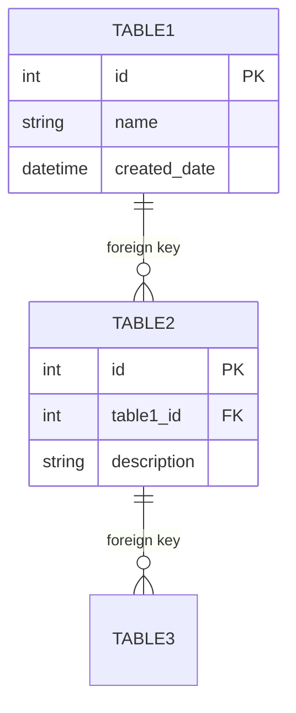
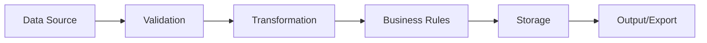

# Documentation Output Templates

These templates ensure consistent documentation format across all generated documents.

## Template 1: Repository Overview

````markdown
# [Repository Name] - System Overview

## Executive Summary
[Brief description of what this system does and its business purpose]

## Technology Stack
- **Primary Language**: [Language]
- **Framework**: [Framework version]
- **Database**: [Database system and version]
- **Key Libraries**: [Important dependencies]
- **Deployment**: [Hosting/deployment platform]

## System Architecture


## Key Components
| Component | Location | Purpose | Dependencies |
|-----------|----------|---------|--------------|
| [Component 1] | [Path] | [Purpose] | [Dependencies] |
| [Component 2] | [Path] | [Purpose] | [Dependencies] |

## Entry Points
- **[Entry Point 1]**: [Description and purpose]
- **[Entry Point 2]**: [Description and purpose]

## Database Components
- **Tables**: [Number] tables managing [domain areas]
- **Stored Procedures**: [Number] procedures for [purposes]
- **Views**: [Number] views for [purposes]

## External Integrations
- **[Integration 1]**: [Purpose and data exchanged]
- **[Integration 2]**: [Purpose and data exchanged]

## Security Considerations
- **Authentication**: [Method used]
- **Authorization**: [How permissions are managed]
- **Data Protection**: [How sensitive data is protected]

## Performance Characteristics
- **Expected Load**: [User volume, transaction volume]
- **Performance Bottlenecks**: [Known limitations]
- **Caching Strategy**: [What is cached and how]
````

---

## Template 2: Business Process Documentation

````markdown
# Business Process: [Process Name]

## Process Overview
**Business Purpose**: [What business goal this achieves]
**Trigger**: [What initiates this process]
**Frequency**: [How often this runs]
**Business Owner**: [Who owns this process]

## Process Flow


## Detailed Steps
### Step 1: [Step Name]
- **Purpose**: [What this step accomplishes]
- **Code Location**: [File and method/class]
- **Input Data**: [What data is required]
- **Business Rules**: [Rules applied in this step]
- **Output**: [What is produced]
- **Error Conditions**: [What can go wrong]

### Step 2: [Step Name]
[Same structure as Step 1]

## Data Dependencies
### Input Data
- **[Data Source 1]**: [Purpose and format]
- **[Data Source 2]**: [Purpose and format]

### Output Data
- **[Data Target 1]**: [What is created/updated]
- **[Data Target 2]**: [What is created/updated]

## Business Rules
| Rule ID | Description | Implementation Location | Impact |
|---------|-------------|-------------------------|--------|
| BR001 | [Rule description] | [Code location] | [Business impact] |
| BR002 | [Rule description] | [Code location] | [Business impact] |

## Exception Handling
- **[Exception Type 1]**: [How it's handled]
- **[Exception Type 2]**: [How it's handled]

## Monitoring and Alerts
- **Success Metrics**: [How success is measured]
- **Error Monitoring**: [How errors are detected]
- **Alerting**: [Who gets notified of issues]
````

---

## Template 3: Database Documentation

````markdown
# Database Schema Documentation

## Database Overview
**Database Name**: [Name]
**Database Type**: [SQL Server, Oracle, MySQL, etc.]
**Purpose**: [Primary business function]

## Schema Diagram


## Table Documentation
### Table: [TableName]
**Purpose**: [Business purpose of this table]
**Record Count**: [Approximate size]
**Growth Pattern**: [How data grows over time]

| Column | Data Type | Nullable | Default | Description | Business Rules |
|--------|-----------|----------|---------|-------------|----------------|
| [col1] | [type] | [Y/N] | [default] | [purpose] | [constraints] |
| [col2] | [type] | [Y/N] | [default] | [purpose] | [constraints] |

**Indexes**:
- **[Index Name]**: [Columns] - [Purpose]
- **[Index Name]**: [Columns] - [Purpose]

**Relationships**:
- **Parent Tables**: [Tables this references]
- **Child Tables**: [Tables that reference this]

**Business Rules**:
- [Rule 1]: [Description and enforcement]
- [Rule 2]: [Description and enforcement]

## Stored Procedures
### Procedure: [ProcedureName]
**Purpose**: [What this procedure accomplishes]
**Called By**: [Applications, jobs, other procedures]
**Frequency**: [How often it's executed]

| Parameter | Type | Direction | Description |
|-----------|------|-----------|-------------|
| @param1 | [type] | IN | [purpose] |
| @param2 | [type] | OUT | [purpose] |

**Business Logic**:
1. [Step 1]: [What happens]
2. [Step 2]: [What happens]

**Error Handling**:
- [Error condition]: [How it's handled]

## Data Maintenance
- **Archival Process**: [How old data is archived]
- **Cleanup Jobs**: [What gets cleaned up and when]
- **Backup Strategy**: [How data is backed up]
````

---

## Template 4: API Documentation

````markdown
# API Documentation: [API Name]

## API Overview
**Base URL**: [URL]
**Authentication**: [Type and method]
**Version**: [Current version]
**Documentation**: [Link to external docs if available]

## Endpoints
### [HTTP Method] [Endpoint Path]
**Purpose**: [What this endpoint does]
**Authentication Required**: [Yes/No and type]

**Request Parameters**:
| Parameter | Type | Required | Location | Description |
|-----------|------|----------|----------|-------------|
| [param1] | [type] | [Y/N] | [path/query/body] | [purpose] |

**Request Example**:
```json
{
  "parameter1": "value1",
  "parameter2": "value2"
}
```

**Response Example**:
```json
{
  "status": "success",
  "data": {
    "result": "value"
  }
}
```

**Error Responses**:
| Status Code | Description | Response Body |
|-------------|-------------|----------------|
| 400 | Bad Request | {"error": "Invalid input"} |
| 401 | Unauthorized | {"error": "Authentication required"} |

**Business Rules**:
- [Rule 1]: [Description]
- [Rule 2]: [Description]
````

---

## Template 5: Data Flow Documentation

````markdown
# Data Flow: [Flow Name]

## Flow Overview
**Purpose**: [Business purpose of this data flow]
**Frequency**: [How often data flows]
**Data Volume**: [Typical volume processed]
**Business Owner**: [Who owns this process]

## Data Flow Diagram


## Data Sources
### Source 1: [Source Name]
- **Type**: [Database, File, API, etc.]
- **Location**: [Path or connection details]
- **Format**: [CSV, JSON, XML, etc.]
- **Update Frequency**: [How often updated]
- **Data Volume**: [Typical size]

## Data Transformations
### Transformation 1: [Name]
- **Input**: [What data comes in]
- **Process**: [What happens to the data]
- **Output**: [What data results]
- **Business Rules**: [Rules applied]
- **Code Location**: [Where implemented]

## Data Destinations
### Destination 1: [Destination Name]
- **Type**: [Database, File, API, etc.]
- **Location**: [Path or connection details]
- **Format**: [How data is stored/sent]
- **Usage**: [How the data is consumed]

## Data Quality Rules
| Rule ID | Description | Implementation | Impact |
|---------|-------------|----------------|--------|
| DQ001 | [Quality check] | [How enforced] | [What happens on failure] |

## Error Handling
- **Validation Errors**: [How handled]
- **Transformation Errors**: [How handled]
- **Storage Errors**: [How handled]

## Monitoring and Alerts
- **Success Metrics**: [How success is measured]
- **Error Detection**: [How errors are caught]
- **Alerting**: [Who gets notified]
````
